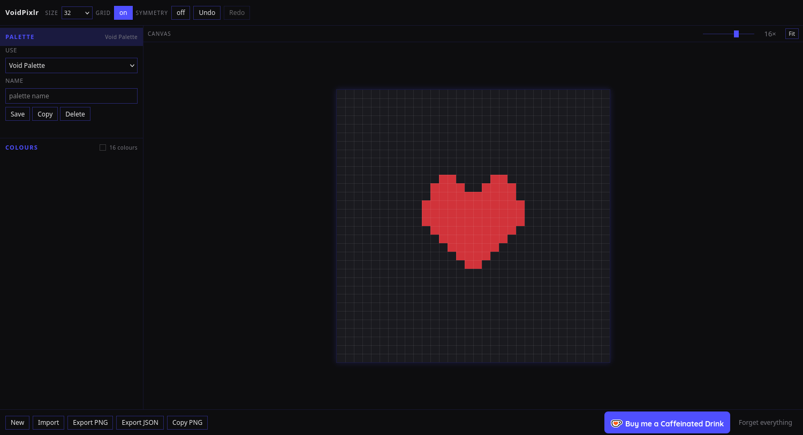
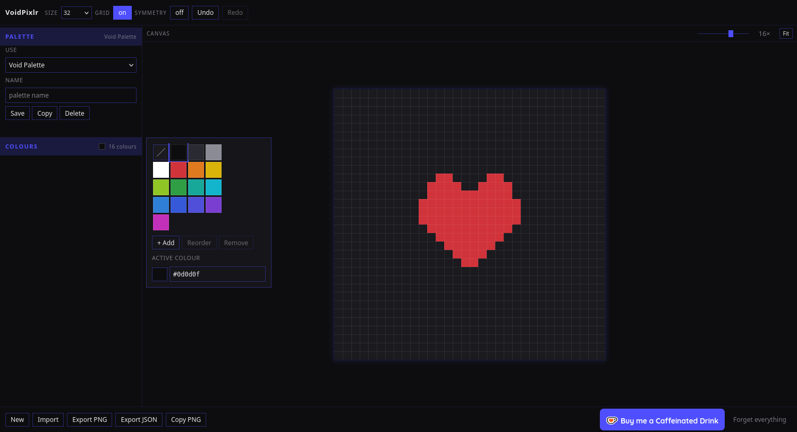

# VoidPixlr

A pixel-art canvas for 16, 32 and 64 px square art. Pick a palette, draw,
save it as a PNG.

**Nothing is uploaded. Nothing is ever sent anywhere.**



> **Working on this project?** [`AGENTS.md`](AGENTS.md) is the handoff
> document: what the project is, how it is built, how it is deployed, and the
> gotchas that have bitten before. Read that first.
>
> [`project.md`](project.md) is the specification — the single source of truth.
> What is written there is what the build does.

## What it is

- **Canvas.** A square, 16, 32 or 64 pixels a side — the size dropdown offers
  exactly those three. Drag-paint with Bresenham interpolation, an explicit
  eraser, mirror symmetry, 50-level undo.
- **Palettes.** The Void Palette (16), Void Expanded (32) and Void Full (64)
  ship built in and are nested, so switching between them never disturbs your
  art. Twelve hue families, each with the same depth in every palette — every
  hue has a ramp to shade with. Build your own at 16, 32 or 64.
- **One menu, on the left.** Palette and colours are two sections that drop
  open, and the colours are a pop-over. Nothing is open until you want it.
- **Import and export.** PNG snapped to the palette, JSON round-trips, older
  project files still load. A file dropped anywhere on the page comes in as
  artwork.
- **Zoom.** 1× to 64× art-pixel scale, plus `Fit`, with a grid that can be
  switched off when it gets in the way.
- **A support button.** The Ko-fi widget sits in the bottom bar and links to
  the project's Ko-fi page.



## Scope

This is a drawing tool. A blank square canvas, a palette, a PNG.

It does not convert photographs into pixel art, and it has no server, no
accounts and no telemetry. If you want a picture turned into a sprite, convert
it elsewhere and bring the result in — a PNG dropped on the page is snapped to
your palette and ready to edit.

## The promise

Anything you bring in — an image, a project file, a paste — is decoded in your
browser, drawn to a canvas, and read back into memory. There is no `fetch`, no
`XMLHttpRequest`, no `sendBeacon`, no `blob:` URL, no form, and no endpoint to
send anything to. The server's access log contains the app's own static files
and nothing else.

Your work *is* stored — on your own machine, in `localStorage`. That is a
deliberate, documented exception to the house rule, and **Forget everything**
wipes the lot in one click.

One thing does load from elsewhere: the **Ko-fi** widget in the bottom bar. It
is a donation button — a script, a cup image and a web font. It receives none
of your work, and the page works exactly the same if it fails to load. What it
does do is tell Ko-fi and Google that a browser opened this page, which on a
LAN-only tool means they learn the visitor's local network address. That is
the trade, and it is written down in the specification rather than hidden.

## The project

```
voidpixlr/
├── site/                  ← the webroot. Exactly what is deployed.
│   ├── index.html
│   ├── 404.html
│   ├── css/style.css
│   └── js/                ← nine modules, loaded in order
├── ops/                   ← nginx vhost, headers, provisioning checklist
├── tests/                 ← the node suite and the Firefox suites
├── tools/                 ← the test-image generator
├── docs/shots/            ← the screenshots used above
├── deploy.sh              ← rsync + vhost install + nginx reload + smoke test
├── serve.sh               ← local preview
├── README.md              ← this file
├── AGENTS.md              ← the handoff document
├── project.md             ← the specification
└── project-v1.0.md        ← the archived v1.0 specification
```

`site/` is the whole site. It holds the page, the stylesheet, the scripts and
the 404 page — twelve files, and nothing else. The deploy copies that
directory and nothing more, so there is no exclusion list to get wrong and no
chance of shipping the tests to a public box.

## Running it

```bash
./serve.sh          # http://127.0.0.1:8790
```

No build step. No dependencies. It serves `site/` as plain static files,
exactly as nginx does in production.

## Deploying it

The site is static: nginx serves a directory of files. There is no runtime, no
backend and no database. `deploy.sh` ships `site/` over SSH, installs the
nginx vhost and the headers file, validates the config with `nginx -t`,
reloads nginx and smoke-tests the result.

```bash
./deploy.sh <ip>
```

The address is mandatory — the script refuses to run without one, because a
checked-in configuration must never name a machine that is already serving
something else.

The vhost in `ops/nginx/voidpixlr.conf` names `192.0.2.0` — the RFC 5737
documentation address — as a placeholder. `deploy.sh` substitutes the real
address when it installs the file.

The site serves its own headers file, `ops/nginx/voidpixlr-headers.conf`: the
house policy with the CSP widened by exactly the three origins the Ko-fi
widget needs. It weakens this site only — every other site keeps the shared
snippet.

`ops/PROVISION.md` is the checklist for standing up a host: cloning the
template, reserving the address, regenerating the SSH host keys and
registering the host. Two of those steps need infrastructure credentials that
are deliberately not stored in this repo, so they are done by hand.

## Testing

```bash
node tests/voidpixlr.test.mjs        # 103 logic checks

python3 tools/make-test-images.py /tmp/vp-images
python3 tests/browser/e2e.py          # 66 end-to-end checks in a real Firefox
python3 tests/browser/hostile.py      # 20 hostile-input checks
```

The browser tests drive a real Firefox over Marionette — a minimal client in
`tests/browser/marionette.py`, no geckodriver, no npm.

### Testing under the real CSP

`python3 -m http.server` sends no `Content-Security-Policy`, so a suite run
against it cannot show that the app works under the policy it is served
with. The `csp_server.py` test server fixes that: it parses the site's own
`ops/nginx/voidpixlr-headers.conf` and sends exactly those headers.

```bash
python3 tests/browser/csp_server.py --port 8791 &
python3 tests/browser/e2e.py --base http://127.0.0.1:8791
python3 tests/browser/hostile.py --base http://127.0.0.1:8791
```

Both suites pass either way. That is the point — the app has no inline script
and no inline event handler, so `script-src 'self'` allows it.

### One Firefox at a time

The browser suites drive a real browser, and only one Firefox can hold the
Marionette port at a time. If another project is running its suites at the
same moment, give one of them a different port:

```bash
python3 tests/browser/e2e.py --port 2829
```

## Licence

MIT — see [`LICENSE`](LICENSE).
